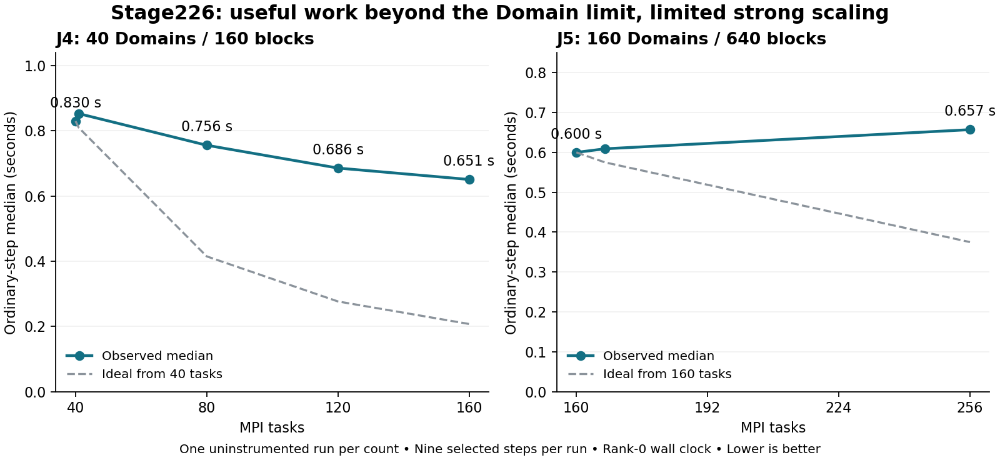

# Stage226 review: correctness passes; strong scaling remains limited

Job 54731 passed all 21 runs and all 33 numerical comparisons exactly on bb13.
Verified 6,386 archive inventory hashes, all six build manifests/log identities,
all seven physical-core placement probes, per-run affinities and the raw
checked-observer lifecycle records. Optimized production/oracle runs contain
neither a Stage223 bypass nor lifecycle files. Every run completed 12 steps,
two reloads and two remaps, with identical adaptive trajectories within each
fixture. Recorded checkpoint hashes agree across all counts/builds per fixture.
Checkpoint binaries are excluded from the archive; detailed comparison reports
were re-evaluated locally, not the original checkpoint bytes.

The tested production integration is successful. At J4 160/40, 120 ranks have
no Domains and each owns one block; J5 256/160 has 96 zero-Domain ranks owning
1–4 blocks. Checked observers show completed useful work on every rank. This
is restart-path correctness/capacity evidence through a 4:1 ratio, not cold-start
or multi-node validation. Git main remains unchanged.

## Strong scaling from ordinary production steps

Use only optimized candidate runs with oracles and lifecycle output disabled.
The existing corrected selection excludes steps 1, 8 and 9: initial startup,
checkpoint/write/reload-containing step, and the first full step after reload.
The retained steps are 2–7 and 10–12, nine per run. Ordinary remaps remain
included. Excluding the two remap steps does not reverse any broad conclusion.
The old `analysis.json` non-checkpoint median is not the corrected statistic.

The printed `cpu =` timer is rank-zero MPI_Wtime around time_step, not CPU
execution time or a measured maximum over ranks. Source identities for the
clock, climate loop and print routine match the cluster candidate manifest.
Stdout prints three significant digits; the higher-precision run_id_log files
were not collected. Whole-process elapsed time includes startup/I/O and is
not used for the scaling estimates below.

Relative efficiency is E(P;P0) = T(P0)*P0/(T(P)*P), with P0=40 for J4 and
P0=160 for J5. The 100% anchor is a normalization, not measured serial efficiency.

| Fixture | Tasks | Ordinary median (s) | Speedup | Relative efficiency |
| --- | ---: | ---: | ---: | ---: |
| J4 | 40 | 0.830 | 1.000 | 100.0% |
| J4 | 41 | 0.853 | 0.973 | 94.9% |
| J4 | 80 | 0.756 | 1.098 | 54.9% |
| J4 | 120 | 0.686 | 1.210 | 40.3% |
| J4 | 160 | 0.651 | 1.275 | 31.9% |
| J5 | 160 | 0.600 | 1.000 | 100.0% |
| J5 | 167 | 0.609 | 0.985 | 94.4% |
| J5 | 256 | 0.657 | 0.913 | 57.1% |



J4 gets a 21.6% time reduction from four times as many tasks; ideal scaling
would yield 0.2075 s at 160 tasks instead of 0.651 s. J5 is 9.5% slower with
60% more tasks; ideal scaling would yield 0.375 s at 256 instead of 0.657 s.
J4 at 160 is faster on all nine matched ordinary steps than at 40; J5 at 256
is slower on all nine than at 160. For J5, excluding remaps gives 0.600 versus
0.664 s, so remap timing is not responsible for the broad result. The small
40→41 and 160→167 differences should not be treated as confirmed regressions.

There is only one independent production run at each task count, in fixed
campaign order, with a short adaptive/restart trajectory. Timesteps share run
conditions and are not independent repetitions. These are screening estimates,
not confidence intervals or a confirmed universal scaling curve. The matched
step evidence supports the direction of the larger changes but does not
establish their repeatability or quantify the contributions of individual phases.

## Interpretation and next measurements

Removing the Domain-count ceiling has not removed the scaling bottleneck.
Useful block ownership is established, but the whole timestep does not scale
in proportion to rank count. The data are consistent with remaining work tied
to Domain owners, communication/synchronization overhead, imbalance and/or
single-node resource contention. They cannot separate those causes. In
particular, the 640-block count does not imply that 640 tasks will be faster,
and the data do not establish that deeper block splitting alone will help.

Next bb run should establish multi-node correctness/capacity with a bounded
160→320→640 ladder and fresh bb reference timings. Use at least one ordinary
production run at each accepted rung, then repeat only the useful comparison
in A–B–B–A order. Do not add another broad instrumentation campaign. Performance
windows should avoid saving and first-restart steps; a longer no-save window
must explicitly handle initialize's current dt_write clamp to time_end.
Collect the already-written high-precision run_id_log file. For a defensible
all-rank timestep measure, a small buffered timer can record per-rank durations
for offline maxima, without per-step timing reductions or file writes.

Do not compare nk and bb timings as a strong-scaling curve: their processors,
node count, memory bandwidth and network placement differ or remain unverified.
A fixed ten-node allocation spread at 16/32/64 ranks per node gives a controlled
bb comparison at 160/320/640, provided each mapping balances sockets and uses
nested physical cores. A packed 5-node/320 to 10-node/640 comparison answers a
different node-scaling question and must be labelled separately.

## bb requirements supplied by the user

Reported nodes bb01–bb12 each expose two sockets and 64 Slurm CPUs. Exclude
bb04, which the user reports unreliable, from builds, placement probes and
solver allocations. Eleven remaining nodes provide 704 configured CPU slots;
640 tasks require ten nodes at 64 per node. This is configured capacity, not a
promise that nodes are currently idle. Explicitly use --exclude=bb04 and reject
any unexpected allocation containing it. Physical cores/SMT, allowed cpusets,
NUMA maps, CPU models and native-build compatibility require per-node checks.
The nk single-host placement map is unsuitable. Requirements are persisted in
`parallel-blocks-bb-campaign-requirements.json`; no bb job or kit is created by
this review.

Reproduce after extracting the archive and retaining the outgoing Stage226 kit:

```bash
python3 test/parallel_block_profile/review_cluster_226.py
```

`parallel-blocks-stage226-review.json` records the detailed checks and scaling
values; `parallel-blocks-stage226-scaling.csv` preserves every included and
excluded timestep. The requested earlier deeper-splitting proposal review
remains a separate follow-up in the Stage226 handoff.
